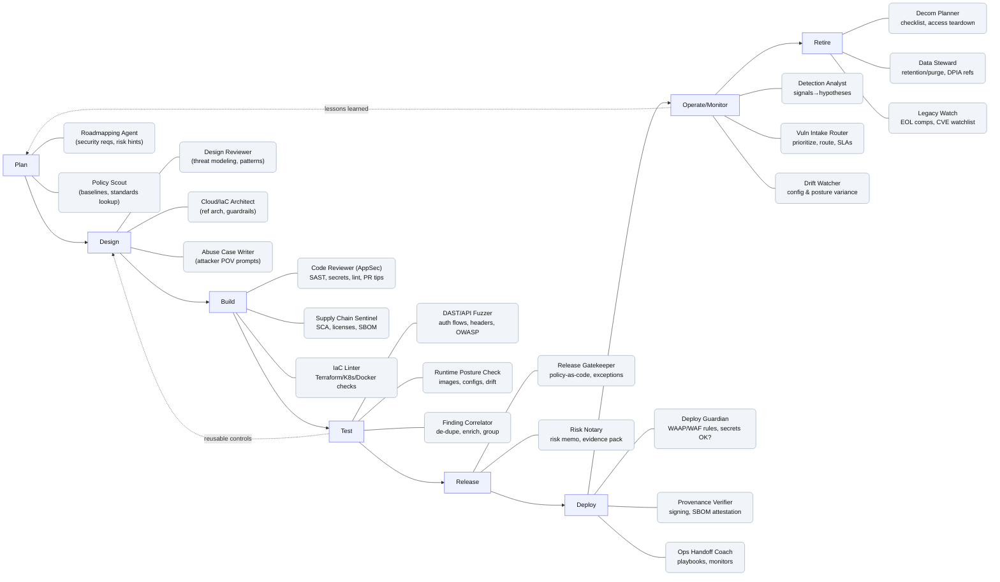

# DevSecOps AI Agent Framework

A comprehensive AI-powered security agent framework spanning the entire Software Development Lifecycle (SDLC).

## 🎯 Overview

This framework provides AI agents that integrate security practices at every phase of the SDLC, from planning to retirement. Each agent is designed to automate security checks, provide intelligent recommendations, and ensure compliance throughout the development pipeline.

## 🔄 SDLC Phases & Agents



## 📁 Repository Structure

```
.
├── phases/
│   ├── 01-plan/          # Planning phase agents
│   ├── 02-design/        # Design phase agents
│   ├── 03-build/         # Build phase agents
│   ├── 04-test/          # Test phase agents
│   ├── 05-release/       # Release phase agents
│   ├── 06-deploy/        # Deploy phase agents
│   ├── 07-operate/       # Operate/Monitor phase agents
│   └── 08-retire/        # Retire phase agents
├── shared/               # Shared utilities and libraries
├── config/               # Configuration files
├── docs/                 # Documentation
└── examples/             # Example implementations
```

## 🚀 Quick Start

### Prerequisites

- Python 3.9+
- Docker (optional, for containerized agents)
- API keys for AI services (OpenAI, Anthropic, etc.)

### Installation

```bash
# Clone the repository
git clone https://github.com/jdempsey77/markup.git
cd markup

# Install dependencies
pip install -r requirements.txt

# Configure environment
cp .env.example .env
# Edit .env with your API keys and settings
```

### Configuration

Create a `.env` file with your settings:

```env
# AI Provider Configuration
OPENAI_API_KEY=your_key_here
ANTHROPIC_API_KEY=your_key_here

# Security Tools
GITHUB_TOKEN=your_token
SONAR_TOKEN=your_token

# Phase-specific settings
ENABLE_PLAN_AGENTS=true
ENABLE_BUILD_AGENTS=true
# ... etc
```

## 🔧 Agent Phases

### 1️⃣ Plan Phase
- **Roadmapping Agent**: Identifies security requirements and risk hints early in planning
- **Policy Scout**: Looks up compliance baselines and security standards

### 2️⃣ Design Phase
- **Design Reviewer**: Performs threat modeling and security pattern validation
- **Cloud/IaC Architect**: Provides reference architectures and guardrails
- **Abuse Case Writer**: Generates attacker perspective scenarios

### 3️⃣ Build Phase
- **Code Reviewer (AppSec)**: SAST scanning, secret detection, linting, and PR recommendations
- **Supply Chain Sentinel**: SCA, license checking, and SBOM generation
- **IaC Linter**: Terraform, Kubernetes, and Docker security checks

### 4️⃣ Test Phase
- **DAST/API Fuzzer**: Tests auth flows, headers, and OWASP Top 10
- **Runtime Posture Check**: Validates container images, configs, and drift detection
- **Finding Correlator**: De-duplicates, enriches, and groups security findings

### 5️⃣ Release Phase
- **Release Gatekeeper**: Enforces policy-as-code and manages exceptions
- **Risk Notary**: Generates risk memos and evidence packages

### 6️⃣ Deploy Phase
- **Deploy Guardian**: Validates WAAP/WAF rules and secrets management
- **Provenance Verifier**: Checks code signing and SBOM attestation
- **Ops Handoff Coach**: Creates playbooks and monitoring configurations

### 7️⃣ Operate/Monitor Phase
- **Detection Analyst**: Converts security signals into actionable hypotheses
- **Vuln Intake Router**: Prioritizes and routes vulnerabilities per SLAs
- **Drift Watcher**: Monitors configuration and posture variance

### 8️⃣ Retire Phase
- **Decom Planner**: Manages decommissioning checklists and access teardown
- **Data Steward**: Handles data retention, purging, and DPIA references
- **Legacy Watch**: Tracks EOL components and CVE watchlists

## 🔄 Feedback Loops

The framework includes intelligent feedback mechanisms:
- **Lessons Learned**: Operations insights feed back into planning
- **Reusable Controls**: Test phase learnings inform design improvements

## 🛠️ Usage

### Running Individual Agents

```python
from phases.plan.roadmapping_agent import RoadmappingAgent

# Initialize agent
agent = RoadmappingAgent(config_path="config/plan.yaml")

# Run security requirements analysis
results = agent.analyze_requirements(
    project="my-app",
    epic_id="EPIC-123"
)

# Get recommendations
print(results.security_requirements)
```

### Running Full Pipeline

```python
from pipeline import DevSecOpsPipeline

# Initialize pipeline with all phases
pipeline = DevSecOpsPipeline()

# Run complete security lifecycle
pipeline.run_all_phases(
    project="my-app",
    branch="main"
)
```

## 📊 Integration Points

The framework integrates with:
- **CI/CD**: GitHub Actions, GitLab CI, Jenkins
- **Security Tools**: SonarQube, Snyk, Trivy, Semgrep, GitLeaks
- **Cloud Platforms**: AWS, Azure, GCP
- **Monitoring**: Prometheus, Datadog, Splunk
- **Ticketing**: Jira, ServiceNow, Linear

## 🤝 Contributing

We welcome contributions! Please see [CONTRIBUTING.md](CONTRIBUTING.md) for details.

### Development Setup

```bash
# Install development dependencies
pip install -r requirements-dev.txt

# Run tests
pytest tests/

# Run linting
flake8 phases/
black phases/
```

## 📖 Documentation

Detailed documentation is available in the `docs/` directory:
- [Architecture Guide](docs/architecture.md)
- [Agent Development Guide](docs/agent-development.md)
- [Configuration Reference](docs/configuration.md)
- [API Documentation](docs/api.md)

## 🔒 Security

This is a security-focused project. Please report security vulnerabilities to security@example.com.

## 📄 License

MIT License - see [LICENSE](LICENSE) for details.

## 🙏 Acknowledgments

Built with modern AI and security best practices, inspired by the DevSecOps community.

## 📞 Support

- Documentation: [docs/](docs/)
- Issues: [GitHub Issues](https://github.com/jdempsey77/markup/issues)
- Discussions: [GitHub Discussions](https://github.com/jdempsey77/markup/discussions)

---

**Status**: 🚧 Active Development

**Version**: 0.1.0

